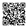
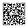
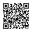
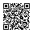
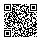
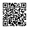
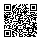
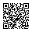
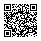
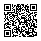

# Auth codes

Patient access codes for eSkrb. On the sign-in screen tap **Skeniraj kodo QR** and scan the user's code, or type the key shown under it.

> These are live credentials. Don't publish this file.

## ana

`esk_9YnthHuR9f0LGLiUQN5BI9iXI6MhmIDNW-GzigMQgBk`

## marko

`esk_zWgDY7oV3_a2JWn3M15NQ7HOPzQ-UeDxw5FoWKOkUiA`

## luka

`esk_Y1KYKXxdtHGnMsg5FsOw_P3elccSz49LeVV2Hit1Yfk`

## nina

`esk_j_x6sre0oSNl8Rx3ZhQQ1DcFVGM-ku3rcWfpCfJM9R8`

## janez

`esk_BeXqRa9AEUv73gmpD7PbybtFjlpCdvfGIZjpoKqVpzo`

## marija

`esk_1raFxhIU76cMmoA8cbJxRJ2aM9lylN2wD8B4K5kz_eE`

## franc

`esk_fGBaQ473EqL0I8N1SG3-F8Mw9om3CdesS2cmokH78Vk`

## ivana

`esk_F4Y1TF1yKKRTGj_OhG8rD4KI9GpTrfqlEHOeAKk-Jzk`

## tone

`esk_YcE_zYBj5i3FISCEdMgDZER8eFEPXoNIks00YMnNUK4`

## milena

`esk_QE1LRpIkKSdGTWrOqCKsJK6mqOvoiotnxo5F2kpBNbY`
