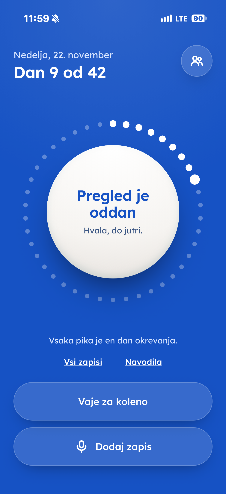
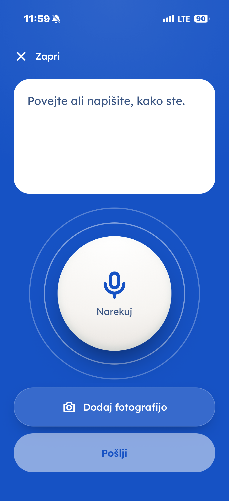
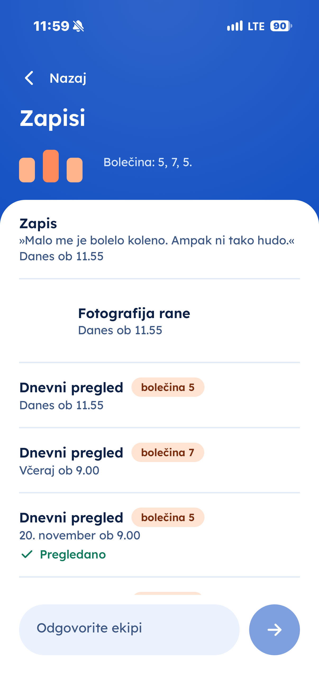
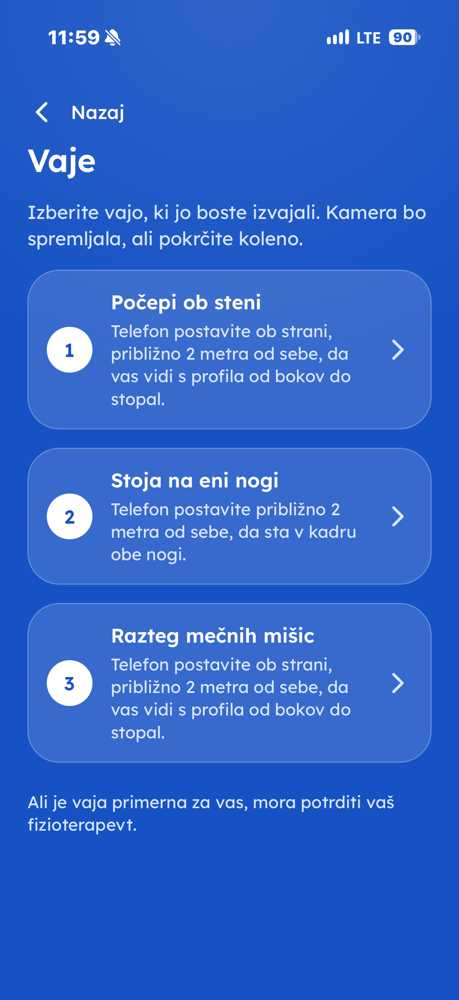
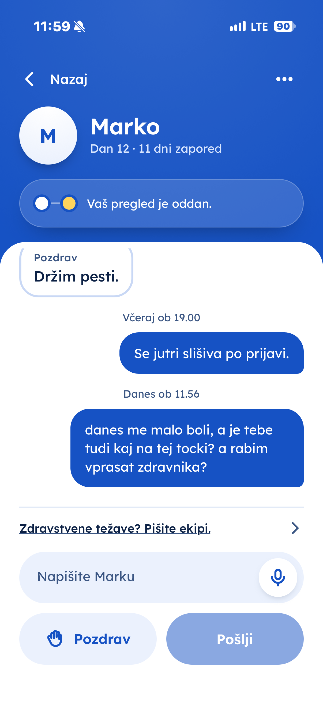

# eSkrb

Ada Hack 2026 project. A mobile app that helps patients log their recovery at home after surgery. Hospital staff see the logs in a triage queue and can reply.

## What the MVP does

The first version covers one loop for one procedure, knee replacement:

1. The patient does a daily check-in or adds a note on the phone (text, voice or photo).
2. The backend checks it against red-flag rules and flags anything concerning.
3. Staff see the patient in a triage queue, review the entries and send a message.
4. The patient sees the reply and a "Pregledano" (reviewed) badge in their timeline.

All patient-facing text is in Slovenian.

## Screenshots

<table>
  <tr>
    <td align="center"></td>
    <td align="center"></td>
    <td align="center"></td>
    <td align="center"></td>
    <td align="center"></td>
  </tr>
  <tr>
    <td align="center">Home: recovery day ring</td>
    <td align="center">New entry: dictate or add a photo</td>
    <td align="center">Entries timeline with pain scores</td>
    <td align="center">Knee exercises with pose detection</td>
    <td align="center">Buddy system chat</td>
  </tr>
</table>

**Demo video:** [watch on Google Drive](https://drive.google.com/file/d/1haiZQGL59Id-UbYqw2-wz5m2jY39M5Xc/view?usp=sharing)

**Android build:** [download eskrb-android-demo.apk](https://github.com/avarra/eskrb-mobile/releases/download/v1.0.0/eskrb-android-demo.apk) and open it on an Android phone. You may need to allow installing apps from unknown sources.

**Try it:** sign in with one of the demo accounts in [AUTH_CODES.md](AUTH_CODES.md). Scan the QR code from the sign-in screen or type the key.

## Stack

- Expo with TypeScript and Expo Router
- OpenID auth via expo-auth-session
- VisionCamera v5 for the camera
- Backend over plain REST and JSON. It mints short-lived Soniox keys and calls the LLM, so no long-lived API keys live on the phone.

## Getting started

```bash
npx expo install
npx expo start
```

Set the API base URL in an env variable. Fixtures mode returns contract JSON so the app runs without the backend.

Dictation streams to Soniox with a single-use key from `POST /stt/temporary-key` and falls back to on-device recognition. Set `EXPO_PUBLIC_STT=device` to use on-device dictation only, or `EXPO_PUBLIC_SONIOX_REGION` to change the Soniox region (default `us`, which must match the backend's Soniox project; use `eu` once the backend mints keys from an EU project).

## More

See [PLAN-mobile.md](PLAN-mobile.md) for the full plan, data model and API contract.
